<div align="center">
  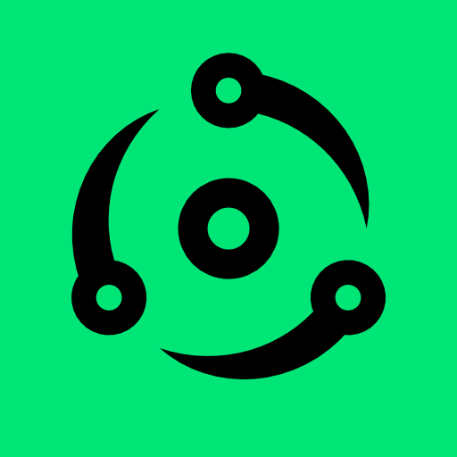
  <h1>CopyManga Neo</h1>


</div>

基于 Kotlin 与 Compose 的拷貝漫畫第三方客户端，提供漫画、轻小说阅读与离线下载。

[下载安装](https://github.com/rchdliang/CopyManga_Neo/releases) · [问题反馈](https://github.com/rchdliang/CopyManga_Neo/issues)

## 功能

- **内容浏览**：漫画推荐、热门更新、最新上架、完结漫画与轻小说；支持作品、作者、汉化组和题材搜索，以及首页标签过滤。
- **书架与阅读记录**：漫画与轻小说收藏、排序、更新提示与阅读状态；支持继续阅读、阅读历史和页面书签。
- **漫画阅读**：单页、双页与自动布局；从左到右、从右到左及竖向连续阅读；整页、等宽与等高显示；缩放、平移和键盘操作。
- **阅读设置**：按漫画保存布局、阅读方向、屏幕方向和缩放方式；按章节调整双页配对；支持翻页动画、音量键翻页、自动阅读与连续跨章。
- **离线下载**：章节选择、下载队列、暂停与恢复、失败重试、并发和速度限制；图片缓存与已下载内容分别管理。Android 支持下载通知与仅 Wi-Fi 下载。
- **图片与章节导出**：单张图片保存、分享，以及 ZIP/CBZ 章节导出。
- **轻小说阅读**：分卷目录、滚动与分页阅读、单栏与双栏排版；系统字体、字重、间距与主题设置；书签、文本标注、正文搜索、插图浏览和离线缓存。
- **评论**：查看作品与章节评论。
- **繁简转换**：使用 OpenCC 的 tw2s 词典将显示文字由繁体转换为简体，支持词典按需下载与更新。
- **外观与数据管理**：浅色、深色和跟随系统主题，Android 动态配色；设置与阅读数据备份、导入和恢复。

### 画质增强（CMP）

- **锐化**：0–100%、5% 一格，默认关闭；Android 需要 Android 13 及以上和硬件加速，桌面使用平台图像滤镜。
- **画质修复（实验）**：使用 Vulkan 执行 Anime4K 同尺寸修复；“关 / Restore / RestoreSoft”按钮组搭配 S、M、L、VL、UL 五档，两种模式独立记忆档位，默认 M。模型随包提供，关闭时滑块不可用。
- **实时调节**：进入调节面板自动放大一次，之后自由缩放、拖动；切换模式或档位、返回阅读画面均保留当前视图。异步更新处理结果；处理失败或设备不支持时显示原图与状态。

画质修复默认关闭，开启时不叠加锐化，处理耗时和画质收益取决于设备与图片。iOS、Web/Wasm 和独立 Android 分支不提供修复功能；输入限制和验证边界见 [画质修复说明](docs/READER-RESTORATION.md)。

## 本地诊断日志（CMP）

在 **我的 → 设置 → 数据管理 → 诊断日志** 中导出或清空“错误与崩溃日志”。默认自动保存警告、错误及可捕获的未处理异常，重新打开应用后仍可导出为 JSONL；普通错误与崩溃分别轮换，总量最多约 1 MiB，长消息和堆栈会截断。网络日志仍需手动开启，单独导出。

日志仅保存在本机，不自动上传，也不包含在个人数据备份中。常见凭据及 URL 查询参数会隐藏，但可能仍有文件路径、内容名称等信息，分享前请检查。Android、桌面在转交原异常处理器前同步保存；iOS 捕获 Kotlin 未处理异常，Web 捕获浏览器错误及未处理的 Promise 拒绝。系统强制结束、断电、原生驱动故障、严重内存耗尽或存储空间不足时，无法保证留下日志；清理浏览器站点数据也会删除日志。

## 界面截图

浏览、书架、个人页和阅读器图片采集自已登录测试账号的 Android 平板，保留实际界面内容；阅读设置、显示设置和画质增强图片由当前 Compose 组件本地渲染，使用固定浅色主题与样例选项。实机启用了系统动态配色，因此与渲染图的颜色可能不同。点击图片可查看原图，来源和更新方式见 [截图说明](screenshots/cmp/README.md)。

漫画、小说片段、封面及作品信息来自内容平台，版权归相关权利方所有；阅读画面仅用于展示客户端界面。画质增强渲染图展示当前 Vulkan 修复控件，不代表 GPU 处理效果或设备性能测试。

<details open>
<summary>浏览与发现：首页、搜索、探索、专题、详情</summary>

<table>
  <tr><th>首页</th><th>搜索与筛选</th></tr>
  <tr>
    <td><a href="screenshots/cmp/android-tablet-home.png">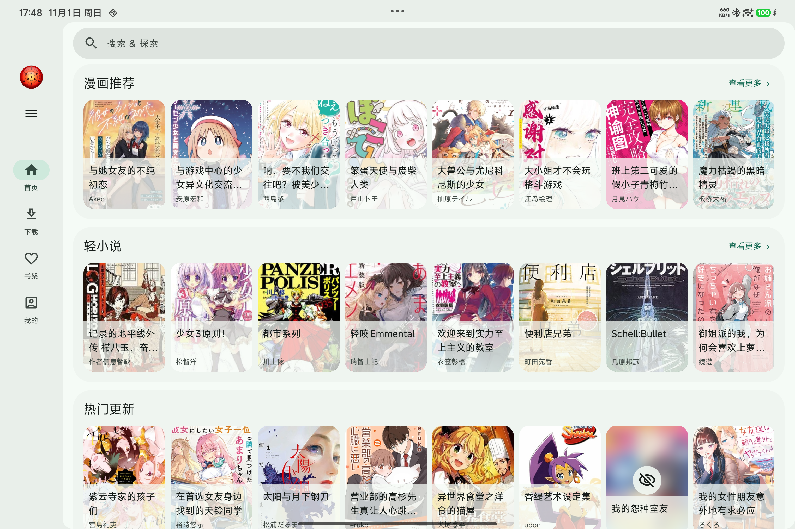</a></td>
    <td><a href="screenshots/cmp/android-tablet-search.png">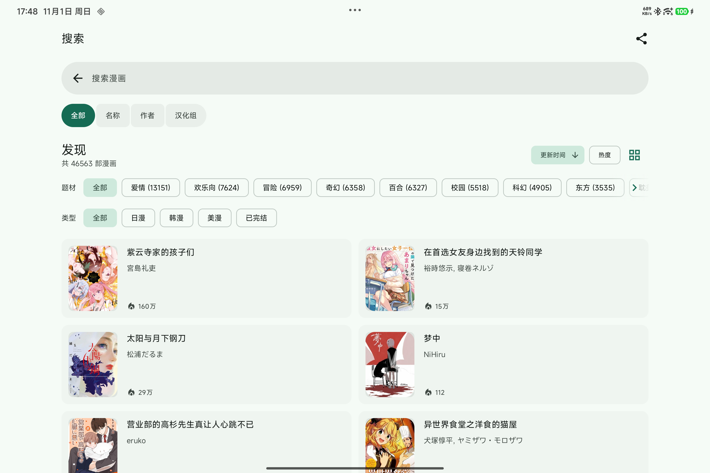</a></td>
  </tr>
  <tr><th>探索：漫画推荐</th><th>漫画专题</th></tr>
  <tr>
    <td><a href="screenshots/cmp/android-tablet-explore.png">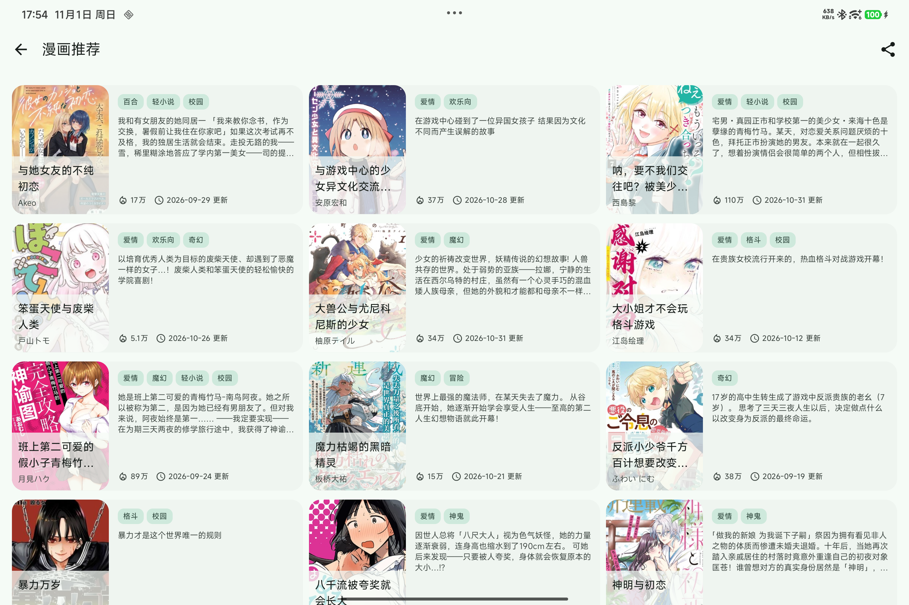</a></td>
    <td><a href="screenshots/cmp/android-tablet-topics.png">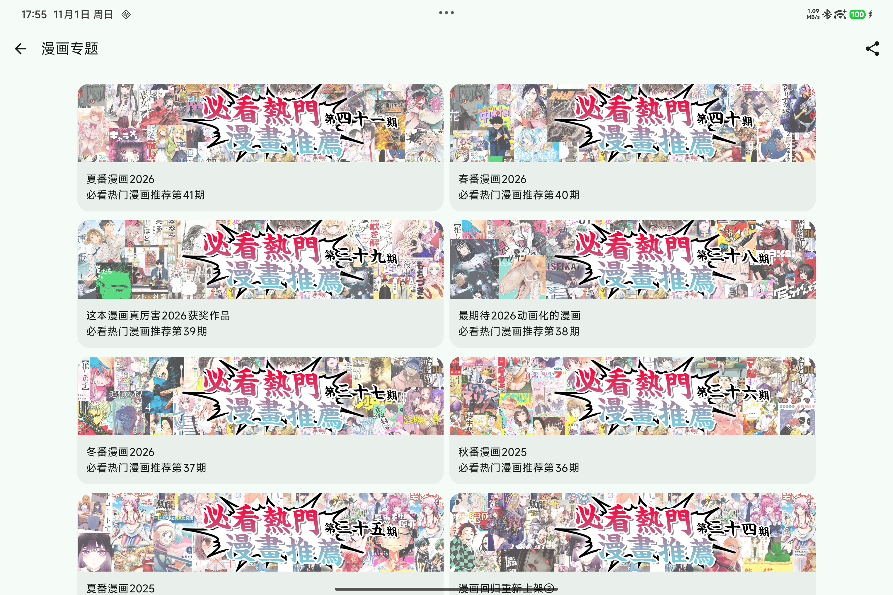</a></td>
  </tr>
  <tr><th colspan="2">详情与章节</th></tr>
  <tr><td colspan="2"><a href="screenshots/cmp/android-tablet-detail.png">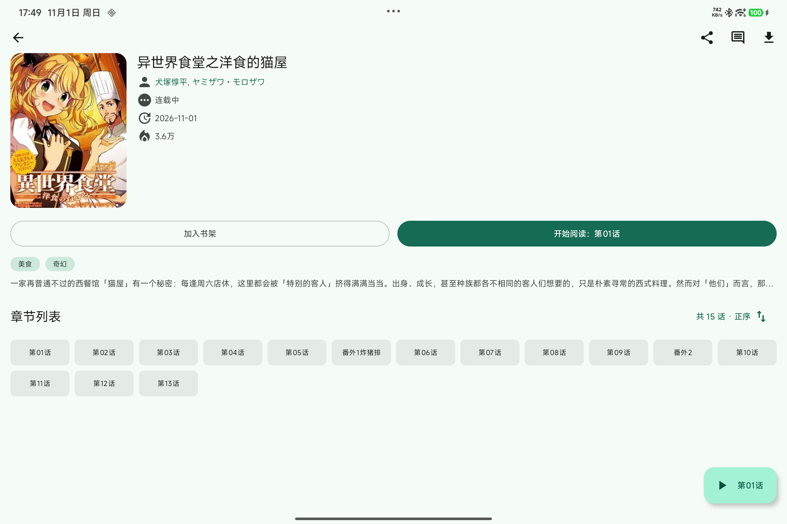</a></td></tr>
</table>

</details>

<details>
<summary>书架与我的</summary>

<table>
  <tr><th>书架</th><th>我的</th></tr>
  <tr>
    <td><a href="screenshots/cmp/android-tablet-bookshelf.png">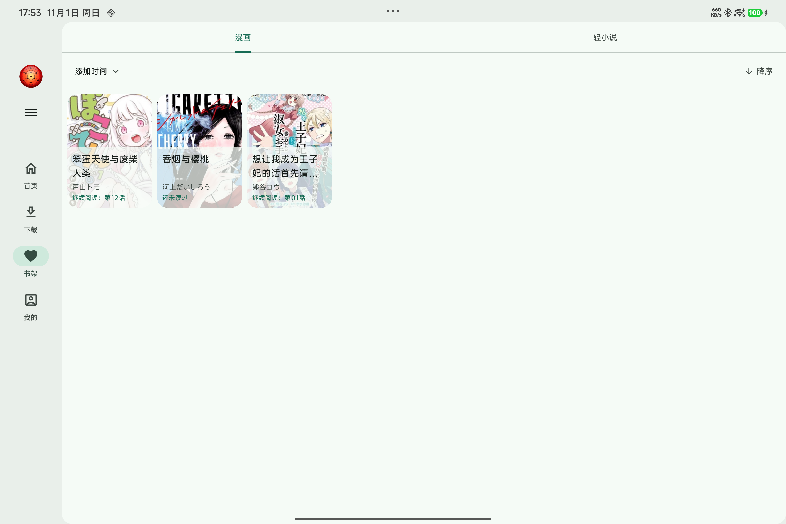</a></td>
    <td><a href="screenshots/cmp/android-tablet-profile.png">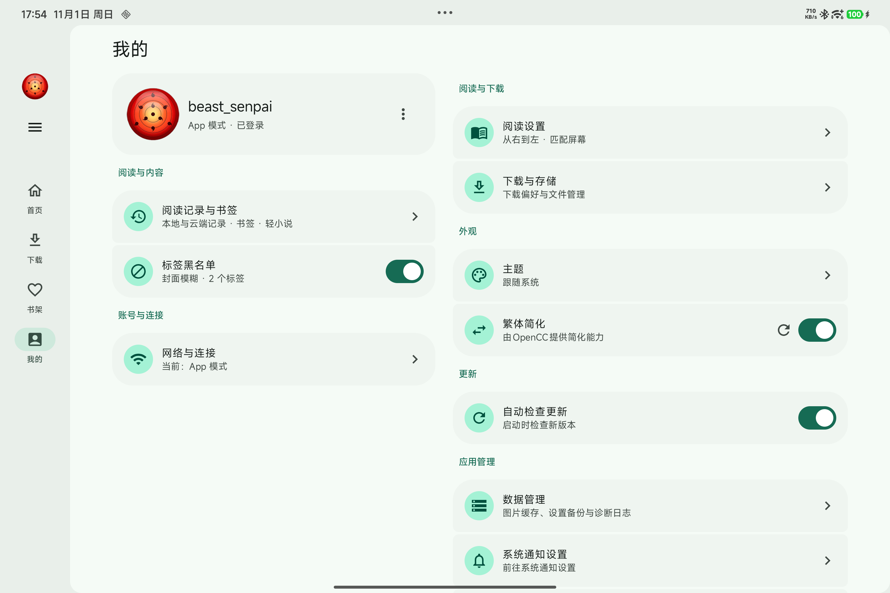</a></td>
  </tr>
</table>

</details>

<details>
<summary>漫画与轻小说阅读</summary>

<table>
  <tr><th>漫画双页阅读（展开工具栏）</th><th>轻小说双栏阅读（展开快捷操作栏）</th></tr>
  <tr>
    <td><a href="screenshots/cmp/android-tablet-comic-reader.png">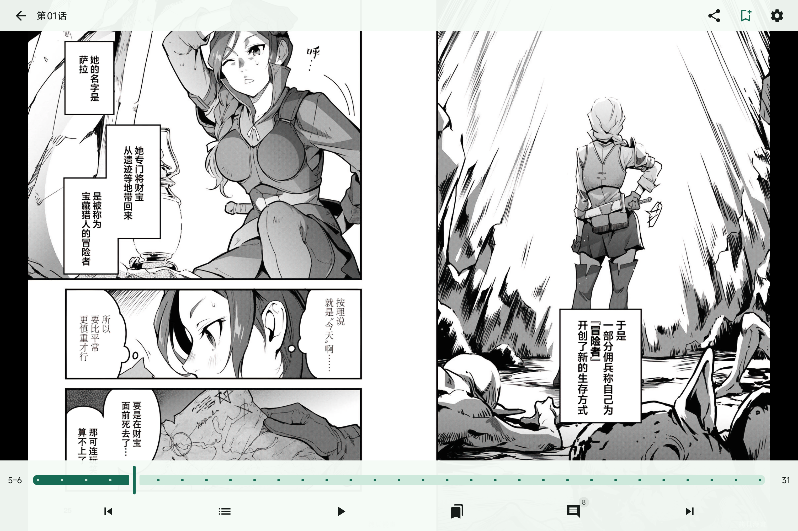</a></td>
    <td><a href="screenshots/cmp/android-tablet-novel-reader.png">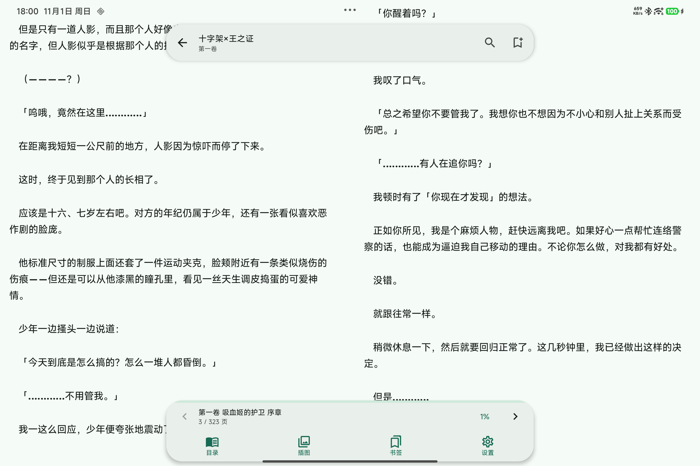</a></td>
  </tr>
</table>

</details>

<details>
<summary>阅读设置与画质增强</summary>

<table>
  <tr><th>阅读设置</th><th>显示设置</th><th>画质增强</th></tr>
  <tr>
    <td><a href="screenshots/cmp/render-reader-settings.png">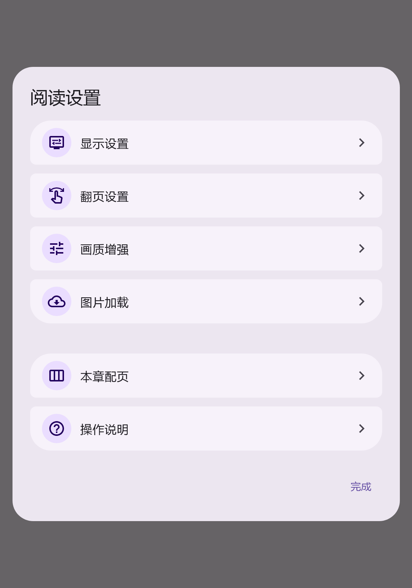</a></td>
    <td><a href="screenshots/cmp/render-reader-display.png">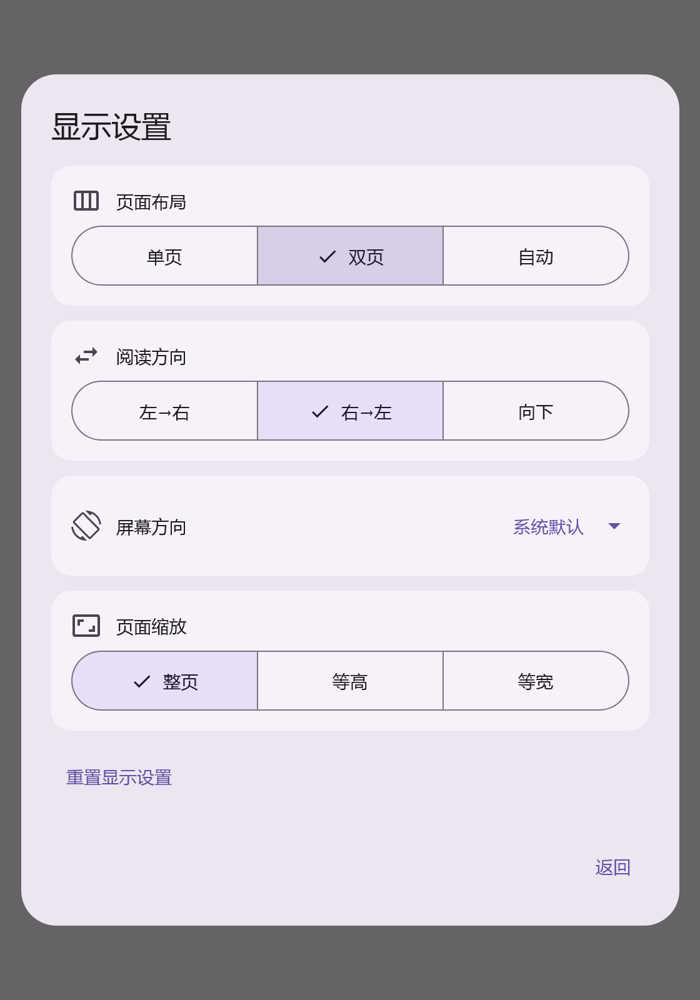</a></td>
    <td><a href="screenshots/cmp/render-reader-quality.png">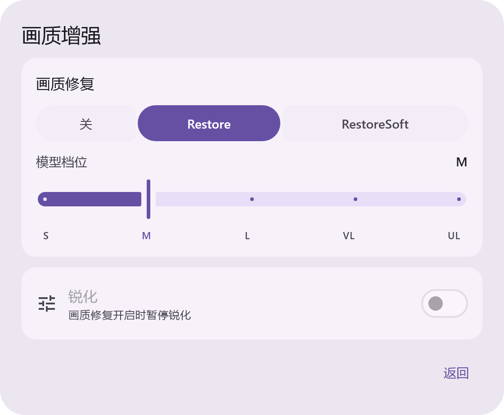</a></td>
  </tr>
</table>

</details>

## 安装

从 [Releases](https://github.com/rchdliang/CopyManga_Neo/releases) 选择对应分支、平台和架构的安装包。Android 使用 APK；Windows 安装包及其他平台产物以对应版本实际提供的文件为准。Windows x64 的正式安装包采用 Nucleus Tao + GraalVM Native Image，交付的原生程序无需安装 Java；日常开发使用 JVM 快速运行，工具链与 IDE 运行方式见 [构建说明](docs/BUILDING.md#桌面)。

CMP 的最新开发构建可在 [Actions](https://github.com/rchdliang/CopyManga_Neo/actions/workflows/cmp-release.yml?query=branch%3ACMP) 中选择成功的运行，从 **Artifacts** 下载。每次推送到 CMP 分支会生成 Android 签名 Release APK（分架构及通用包）和 Windows x64 安装程序、免安装 ZIP；iOS ARM64 IPA 由[手动多平台工作流](https://github.com/rchdliang/CopyManga_Neo/actions/workflows/multiplatform-manual.yml)生成。

iOS 使用 `CopyMangaNeo_ios_<版本+提交数>_arm64_unsigned.ipa`，为未签名真机包，需要通过 SideStore / AltStore 等工具自行签名安装。覆盖更新时保持相同的签名身份和应用标识，并先备份数据；iOS 下载需保持应用在前台。

正式发布使用 `v<版本号>` 标签。维护者先取得同一提交的 Android、Windows 和 iOS 成功构建，再手动运行 **CMP builds and release draft** 汇总原产物与构建清单，不重复编译。附件 SHA-256 摘要由 GitHub 提供，不另附校验文件。标签本身不触发 CMP 构建或公开发布；草稿仍需验收后手动公开，详细流程见[发布说明](docs/BUILDING.md#cmp-自动构建及三端发布草稿)。

已创建标签时，在手动发布的 `release_tag` 输入中填写该标签。发布脚本会读取标签对应提交的版本和构建产物，因此后续发布工具修复不会改变已选定的应用源码或安装包。

Android 覆盖更新需要包名与签名一致。CMP 与独立 Android 不能相互覆盖更新；更新前可在应用内备份数据。

CMP 更新弹窗中，Android 的“GitHub”按钮会按设备支持的架构直接打开对应 APK 下载地址；缺少分架构包时尝试通用包。Windows 按当前架构提供“ZIP”和“EXE”下载按钮。没有兼容附件时回到该版本的发布页；文件下载交给系统或浏览器处理，不会自动安装。

## 版本与平台

本文以 **CMP 分支**为主，独立 Android 分支的差异见下表。

原生 Android 版本计划近期停止维护，后续仅维护 CMP 版本。CMP 将作为项目的持续开发主线。

| 项目 | CMP 分支 | Android 分支 |
| --- | --- | --- |
| 平台 | Android、Windows、macOS、Linux、iOS；另有 Web/Wasm 构建目标 | Android |
| 画质修复（实验） | Android、Windows、Linux 的 Vulkan GPU | 暂无 |

当前 Windows、Android 和 iOS 均已确认可在实机运行。Windows 与 Android 已经过较完善的测试；iOS 已通过云端真机的基础运行测试，测试覆盖仍有限。

两个分支的 Android 应用均要求 Android 12 及以上，使用不同包名，可以并存；应用数据分别保存，完整用户数据备份不能直接互导；轻量设置备份的覆盖范围见各分支 [PERSISTENCE.md](PERSISTENCE.md)。iOS、Web/Wasm 及桌面平台的构建条件和系统能力差异见 [构建说明](https://github.com/rchdliang/CopyManga_Neo/blob/CMP/docs/BUILDING.md)与[架构说明](https://github.com/rchdliang/CopyManga_Neo/blob/CMP/docs/ARCHITECTURE.md)。

## 构建

使用完整 JDK 21 和仓库自带的 Gradle Wrapper。CMP 构建还需要可用的 Git 和完整提交历史；请通过 Git 克隆，浅克隆先执行 `git fetch --unshallow`，源码 ZIP 不包含版本计数所需的历史。Android 构建需要项目指定版本的 Android SDK；iOS 构建需要 macOS 与 Xcode。

### CMP 分支

```powershell
# CMP Android Debug
.\gradlew.bat :app:assembleDebug

# CMP 桌面 JVM 快速运行（Windows x64 使用当前 Nucleus 窗口）
.\gradlew.bat :desktopApp:run -PenableAndroid=false
```

macOS/Linux 使用 `./gradlew`。macOS 默认使用 Nucleus/Tao，可在[手动多平台工作流](https://github.com/rchdliang/CopyManga_Neo/actions/workflows/multiplatform-manual.yml)选择 macOS 生成两种架构的 DMG / ZIP，详见[macOS 构建说明](docs/BUILDING.md#macos)。CMP Android、Windows、Linux 的普通构建会编译并打包 Vulkan 修复运行库和十组模型；全新环境需要准备 Python、CMake 与 C++ 编译器。桌面跨平台打包需要提供匹配目标的预编译库。

平台打包、签名、版本配置与网络配置见 [构建说明](https://github.com/rchdliang/CopyManga_Neo/blob/CMP/docs/BUILDING.md)，同尺寸 GPU 修复原型的模型来源与限制见 [画质修复说明](docs/READER-RESTORATION.md)。请勿提交本地签名材料、账号凭据或私有配置。

### 原生 Android 分支

原生 Android 分支为独立的 `:app` 工程，不包含 CMP 桌面模块或 AI 原生运行库构建任务。

```powershell
.\gradlew.bat :app:assembleDebug
.\gradlew.bat :app:assembleRelease
```

Release 构建需要本地 `keystore.properties` 和对应签名密钥库。SDK 与依赖版本以该分支的 `app/build.gradle.kts`、`gradle/libs.versions.toml` 为准。

## 测试进度与平台边界

| CMP 平台 | 当前测试情况与限制 |
| --- | --- |
| Android | 日常功能已进行较充分的实机测试，整体可用，仍可能存在缺陷。新 Vulkan 画质修复已通过编译，尚未进行真机验收。 |
| Windows | 桌面验证主要在 Windows 进行，已检查启动、阅读器及部分原生增强功能；部分界面仍需优化，部分功能尚未充分测试。 |
| macOS | 已接入 Nucleus/Tao，提供 Apple Silicon / Intel 的 DMG 与 ZIP 构建目标，随包包含 JVM；尚待 macOS 构建与真机验收，默认没有 Developer ID 签名或公证，暂无 Vulkan 画质修复。 |
| Linux | 画质修复已通过软件 Vulkan 计算与 JNI 验证，尚未经过硬件 GPU 或完整界面实机验证。 |
| iOS | 尚未经过 iPhone/iPad 实机验证；构建成功不代表安装、系统交互与日常功能已验证可用。工程最低部署目标为 iOS 16。 |
| Web/Wasm | 测试有限，尚未完成全面功能验证；受浏览器跨域、后台执行、文件与存储能力限制。 |

Web/Wasm 的具体边界：

- API 和图片加载受上游 CORS 策略约束；纯静态托管不能直接读取未开放跨域的漫画图片。部署方式与所需宿主能力见构建说明，不保证仅上传静态文件即可完整使用。
- 页面隐藏时暂停下载，不保证关闭页面后继续后台任务，也不支持严格的仅 Wi-Fi 网络绑定。
- 设置使用 local storage，二进制内容使用 IndexedDB，持久性与容量受浏览器策略影响；当前账号凭据仅保留在内存。
- 文件导出依赖浏览器的 File System Access 能力；分享、剪贴板、文件选择、通知和全屏等操作受浏览器支持情况与用户手势要求限制。
- 当前不提供锐化或 AI 增强。

## 已知限制与反馈

- 在线内容和账号功能依赖上游服务；遇到请求限流时应停止重试并稍后再试。
- Android 支持后台下载；桌面需要应用进程保持运行，iOS 下载要求保持前台，Web 受浏览器后台执行、存储与跨域策略限制。
- 系统手势导航提示可能由系统临时显示；沉浸阅读不禁用系统返回手势。
- 提交 [Issue](https://github.com/rchdliang/CopyManga_Neo/issues) 时，请注明分支、完整应用版本（CMP 包含 `+提交数`）、系统版本、设备型号与复现步骤；使用 Actions 构建时附上运行链接或提交哈希，必要时附上截图和应用导出的日志。

## 项目与许可

本项目为 AI 辅助开发的个人学习和测试项目，与拷貝漫畫官方无关，不接受赞助。漫画及轻小说内容来自拷貝漫畫，版权归原作者及相关权利方所有。

项目代码采用 [GNU General Public License v3.0](LICENSE)。第三方库、原生运行时和模型保留各自许可证。致谢 [fumiama/copymanga](https://github.com/fumiama/copymanga) 及项目使用的开源组件。

- [OpenCC](https://github.com/BYVoid/OpenCC)：繁简转换使用其 tw2s 词典数据，转换逻辑由本项目实现。词典与上游项目采用 [Apache License 2.0](https://github.com/BYVoid/OpenCC/blob/master/LICENSE)，相关许可随应用保留。
- [Anime4K](https://github.com/bloc97/Anime4K)：Restore / RestoreSoft 五档画质修复模型，Copyright (c) 2019–2021 bloc97，采用 MIT 许可证。保留原始权重，纹理绑定包装由本项目适配为 Vulkan compute；完整许可证、版权及改动说明随模型分发。
- [Vulkan-Headers](https://github.com/KhronosGroup/Vulkan-Headers)：画质修复使用的 Vulkan 接口头文件，Copyright 2014–2024 The Khronos Group Inc.；本项目纳入的头文件均采用 Apache-2.0，保留原始文件头与随包许可证、版权说明。
- [Kixyu Book](https://github.com/kkyu9527/kixyubook)（kkyu9527）：轻小说阅读器的分页、目录快速滚动及文本选择菜单部分代码改编自该项目，采用 [MIT License](https://github.com/kkyu9527/kixyubook/blob/main/LICENSE)。原版权与许可声明保留在源码及随包许可证中。

This project is tested with BrowserStack