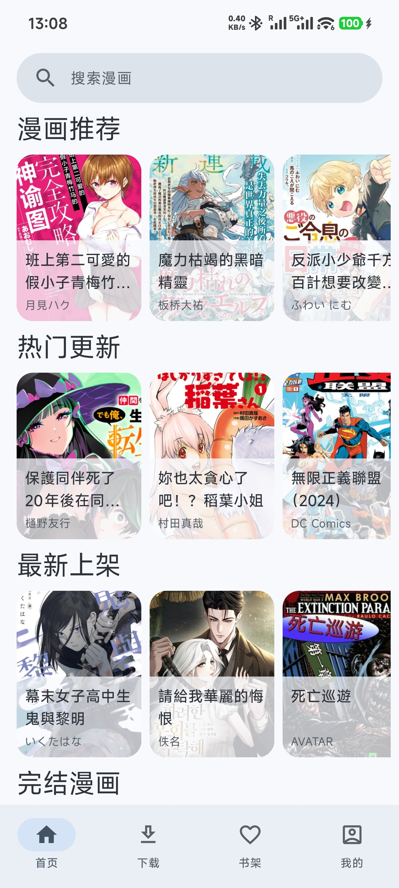
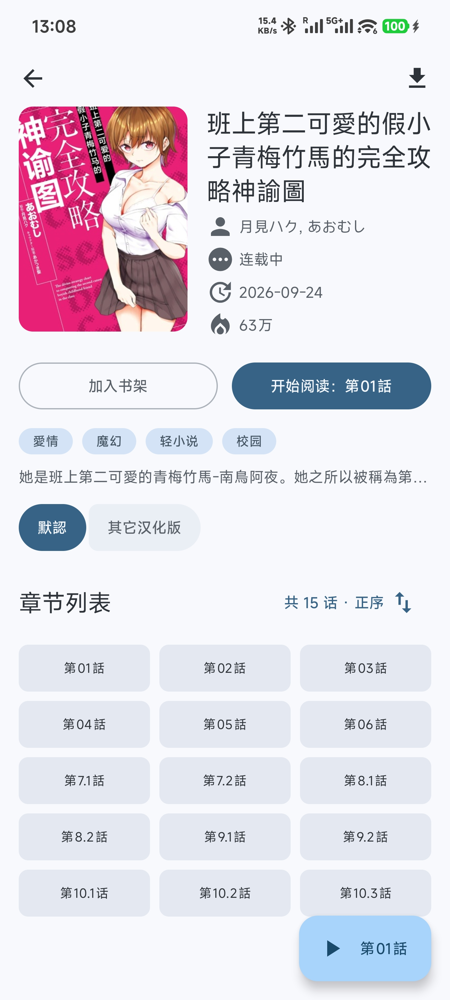
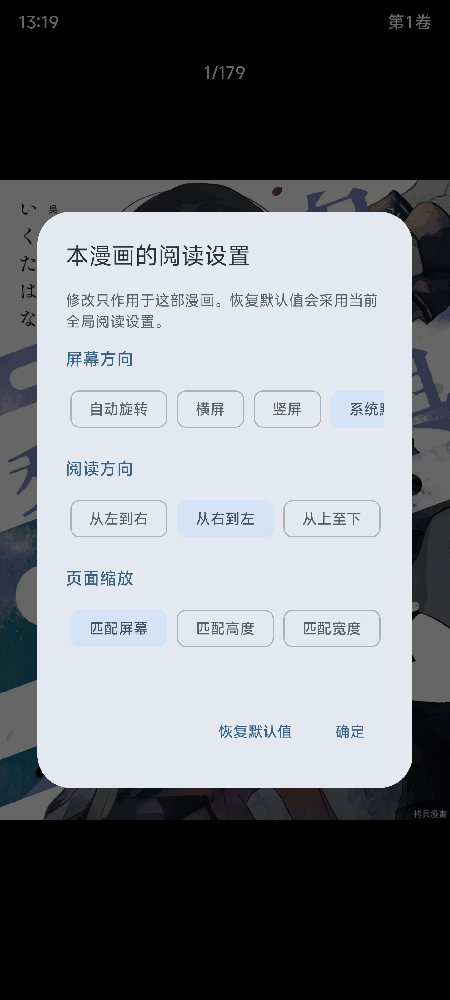
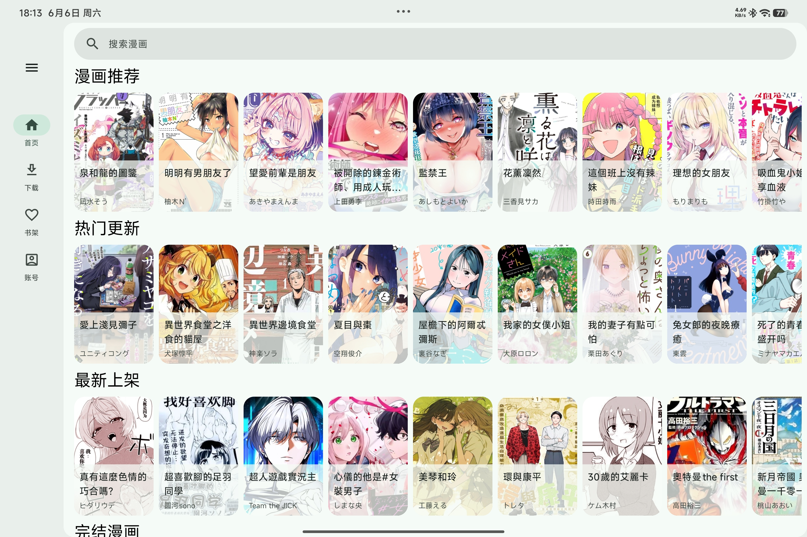

> Compose Multiplatform migration in progress, based on upstream commit `466cef7c6acd2f082a9f7432cc06a082d83bc1c9`. Android now uses shared UI. See [build instructions](docs/BUILDING.md), [verification status](docs/MIGRATION_STATUS.md), and [iOS/browser setup](docs/IOS_BROWSER.md). Original project documentation follows.

  
  <h1>CopyManga Neo</h1>
  
拷貝漫畫的第三方 Android 客户端

  
发现漫画、书架追更、按习惯阅读，也能下载后离线看。

  

    <a href="https://github.com/rchdliang/CopyManga_Neo/releases">下载 APK</a>
    ·
    <a href="https://github.com/rchdliang/CopyManga_Neo/issues">反馈问题</a>
  

## 功能与特点

### 按自己的习惯阅读

- **三种阅读方向**：从右到左、从左到右翻页，或从上至下连续阅读。
- **调整图片显示**：匹配屏幕、宽度或高度，支持双指缩放和拖动查看细节。
- **全屏与横竖屏**：阅读时收起状态栏，可锁定横屏、竖屏，也可自动旋转或跟随系统。
- **快速定位**：点击或滑动翻页，拖动进度条跳页，切换上一章、下一章。
- **每部漫画单独记住设置**：阅读方向、图片缩放方式和屏幕方向分别保存；也可以设置新打开漫画使用的全局默认值。

### 下载后，没网也能看

- **按章节下载**：在详情页长按章节进入管理模式，支持多选、全选、反选和区间选择。
- **管理下载任务**：查看进度与速度，暂停、继续、重试或取消任务；支持后台下载和下载通知。
- **保留未完成的队列**：重新打开应用后，可以在下载页手动继续任务，已完整下载的章节会保留。
- **仅 Wi-Fi 下载**：离开 Wi-Fi 后等待，重新连接后继续，方便控制流量使用。
- **离线阅读与清理**：从下载页打开本地漫画，在已下载且章节关系明确的相邻章节之间切换；支持批量删除下载。图片缓存也可单独清理，保留已下载漫画。

### 追更，也能接着上次的章节读

- **账号书架**：登录后收藏漫画、查看书架，并批量移除不再追的作品。
- **更新提示**：书架卡片标记有新内容的漫画，导航角标显示数量。
- **继续阅读**：记录读到的章节，从详情页接着读；登录后同步阅读记录。
- **浏览记录**：登录后查看读过的漫画，支持加载更多和清空记录。
- **账号使用更方便**：支持记住密码、自动登录，以及登录凭据的导入与导出。

### 发现漫画，调整首页内容

- **首页浏览**：漫画推荐、热门更新、最新上架和完结漫画。
- **多种搜索入口**：按漫画名称、作者或汉化组搜索，也可点击详情页的题材标签查找同类作品。
- **章节目录**：查看漫画简介、作者、题材和更新信息，切换章节分组与正序、倒序排列。
- **标签黑名单（实验性）**：长按详情页的题材标签加入黑名单，在“我的”中统一管理。过滤仅影响首页，不影响搜索和书架；未登录也能使用。标签信息不完整时，部分漫画可能暂时无法过滤。

### 手机和平板都能用

- 根据窗口宽度切换底部导航与侧边导航，适应手机和平板的浏览方式。
- 支持浅色、深色和跟随系统主题，并使用系统动态配色。

## 界面预览

以下为 2026 年 9 月 24 日的实际截图，点击图片可查看原图。

<table>
  <tr>
    <th>发现漫画</th>
    <th>详情与章节</th>
    <th>每部漫画的阅读设置</th>
  </tr>
  <tr>
    <td></td>
    <td></td>
    <td></td>
  </tr>
</table>

<table>
  <tr>
    <th>下载进度与本地漫画</th>
    <th>书架与更新提示</th>
  </tr>
  <tr>
    <td></td>
    <td></td>
  </tr>
</table>

  

平板横屏：侧边导航与更宽的浏览空间

## 下载安装

需要 **Android 12 或更高版本**，目前提供 Android 手机和平板版本。

1. 打开 [Releases](https://github.com/rchdliang/CopyManga_Neo/releases)。
2. 在对应版本的 **Assets** 中下载 `.apk` 安装包。
3. 在设备上打开安装包，按系统提示允许安装并完成安装。

本文介绍当前源码中的功能；安装包的具体变化请查看对应版本的发布说明。

## 使用与反馈

- 书架与浏览记录需要登录拷貝漫畫账号。导出的登录凭据等同于账号登录权限，请妥善保管。
- 当前尚未提供评论与单张图片保存功能。离线阅读请使用章节下载。
- 在线内容与账号功能依赖拷貝漫畫服务。遇到访问限制时，应用会提示并暂停相关请求，请稍后重试。
- 遇到问题或有功能建议，欢迎提交 [Issue](https://github.com/rchdliang/CopyManga_Neo/issues)
  。描述问题时，请附上应用版本、Android 版本、设备型号和复现步骤，必要时补充截图。

## 关于项目

这是一个使用 AI 辅助开发的个人学习项目，仅用于学习和测试，请于下载后 24 小时内删除。不保证应用稳定性或后续维护更新。

本项目与拷貝漫畫官方无关。漫画数据来自[拷貝漫畫](https://www.copy3000.com/)
，所有漫画内容版权归原作者及相关权利方所有。本项目通过公开网站接口获取内容，不提供破解内容。

本项目不接受赞助。如希望支持内容平台，请支持[拷貝漫畫官方](https://www.copy3000.com/)。

致敬 [fumiama/copymanga](https://github.com/fumiama/copymanga)。

## 开源许可

本项目采用 [GNU General Public License v3.0](LICENSE) 开源许可证。
