

  
  <h1>CopyManga Neo</h1>
  
基于 Kotlin 与 Jetpack Compose 的<a href="https://copy4000.com/">拷贝漫画</a>第三方客户端，可发现、收藏和离线阅读漫画与轻小说。

  

    
    
    
  

  <a href="https://github.com/rchdliang/CopyManga_Neo/releases/latest">下载最新</a>
  &nbsp;·&nbsp;
  <a href="https://github.com/rchdliang/CopyManga_Neo/issues">反馈问题</a>

## 下载安装

| 平台 | 安装方式 |
| --- | --- |
| Android 12 及以上 | 下载 APK。大多数手机和平板选 `arm64-v8a`，不确定时选 `universal` 通用包。 |
| Windows x64 | 下载 `setup.exe` 安装，或解压 `portable.zip` 直接运行。 |
| iOS 16 及以上 | 下载未签名的 `.ipa`，通过 SideStore 或 AltStore 签名安装。下载漫画时请保持应用在前台。 |

Android 和 Windows 是主要测试平台，也提供[开发版下载](https://github.com/rchdliang/CopyManga_Neo/actions/workflows/cmp-release.yml?query=branch%3ACMP)；iOS 的常用基本功能已在真机上测试；
macOS、Linux 和 Web 版极少/未经实机测试，安装包和构建方式见[其他平台构建说明](docs/BUILDING.md)。

## 界面截图

<table>
<tr><th>首页 · 标签黑名单</th><th>漫画双页阅读</th></tr>
<tr><td><a href="screenshots/cmp/android-tablet-home.png">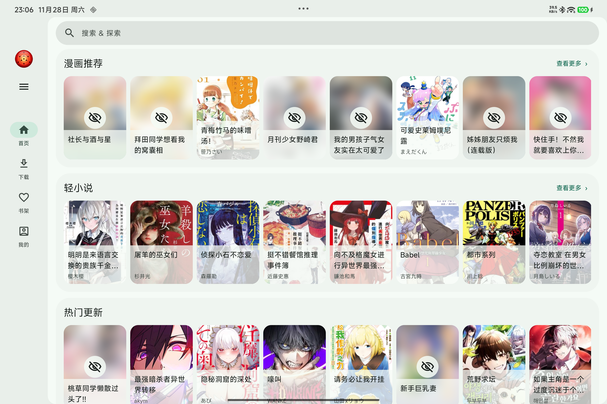</a></td><td><a href="screenshots/cmp/android-tablet-comic-reader.png">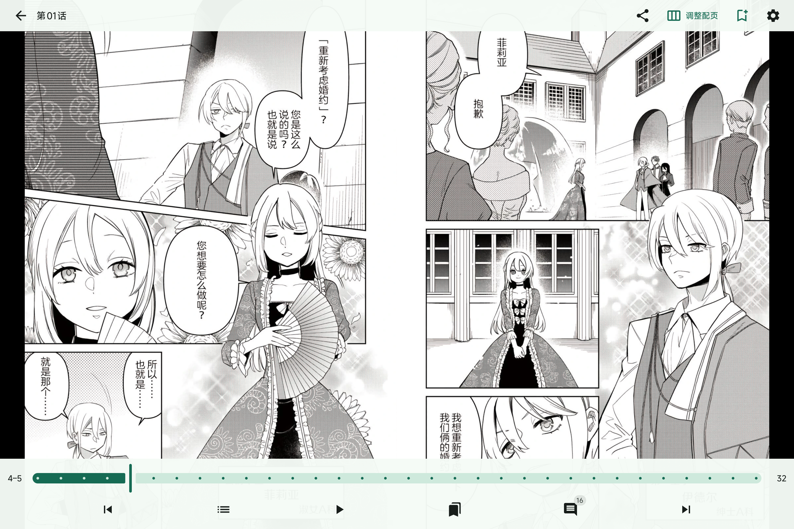</a></td></tr>
<tr><th>轻小说双栏阅读</th><th>离线下载 · 选择章节</th></tr>
<tr><td><a href="screenshots/cmp/android-tablet-novel-reader.png">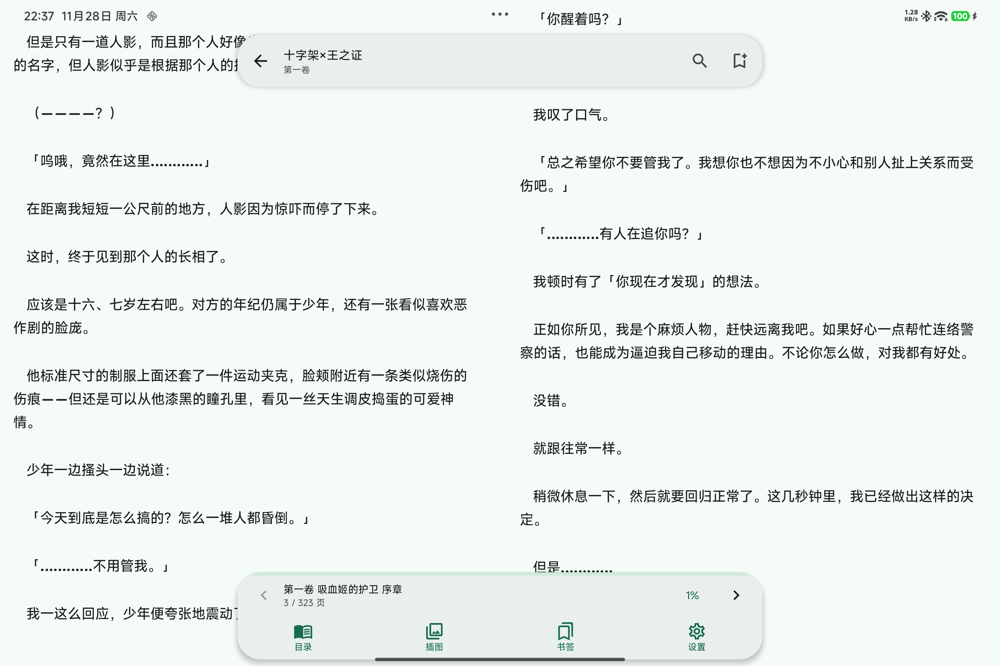</a></td><td><a href="screenshots/cmp/android-tablet-download-selection.png">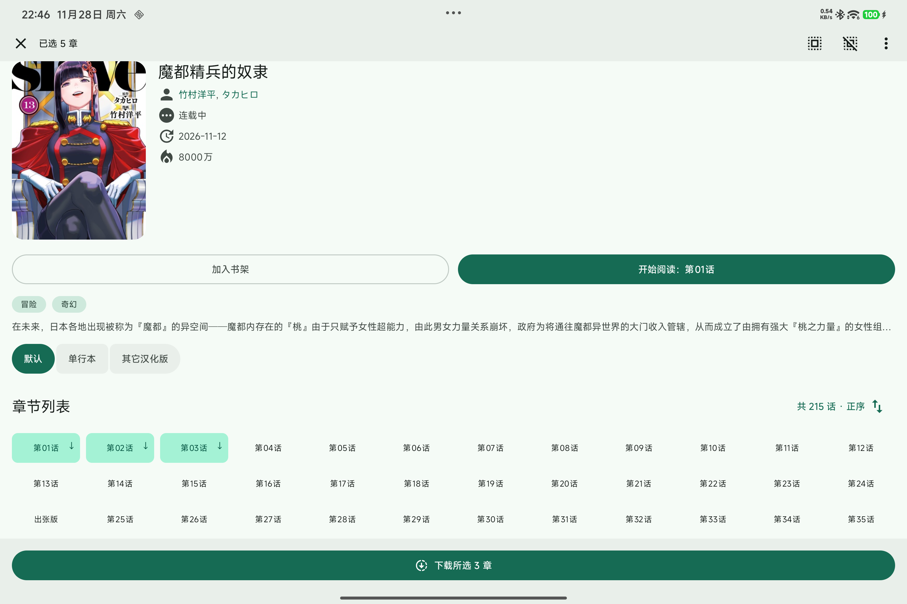</a></td></tr>
</table>

浏览与书架

<table>
<tr><th>搜索与筛选</th><th>书架</th></tr>
<tr><td><a href="screenshots/cmp/android-tablet-search.png">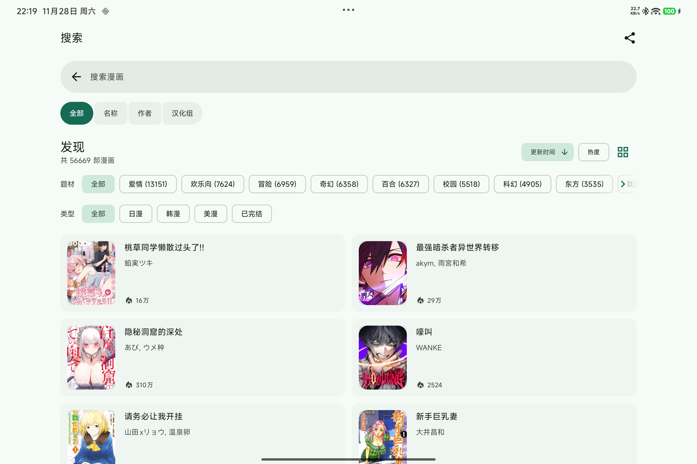</a></td><td><a href="screenshots/cmp/android-tablet-bookshelf.png">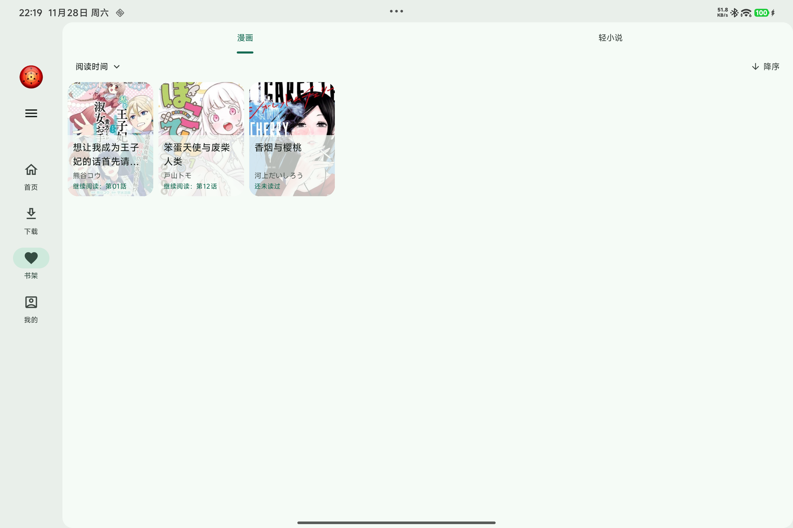</a></td></tr>
<tr><th>作品详情</th><th>专题</th></tr>
<tr><td><a href="screenshots/cmp/android-tablet-detail.png">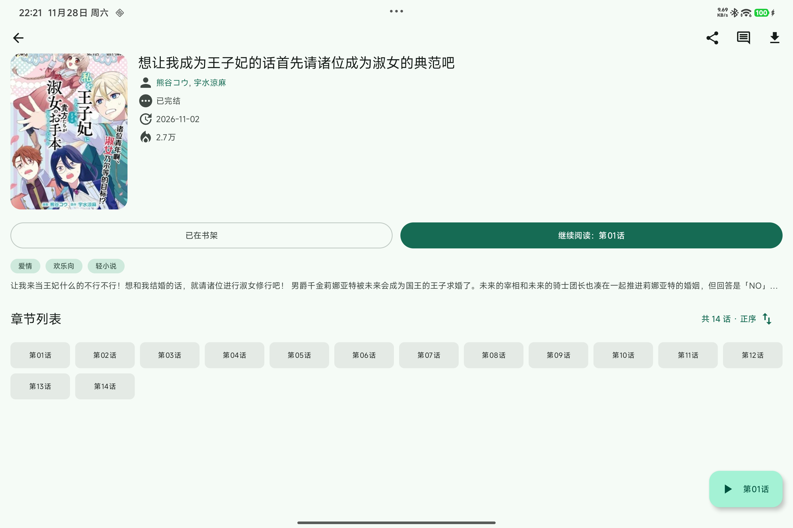</a></td><td></td></tr>
<tr><th>探索</th><th>我的</th></tr>
<tr><td><a href="screenshots/cmp/android-tablet-explore.png">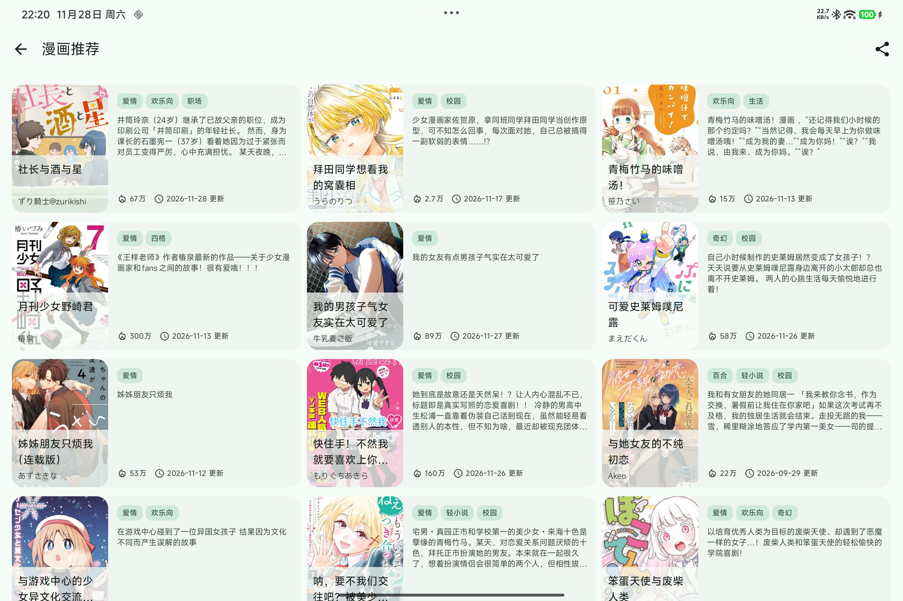</a></td><td><a href="screenshots/cmp/android-tablet-profile.png">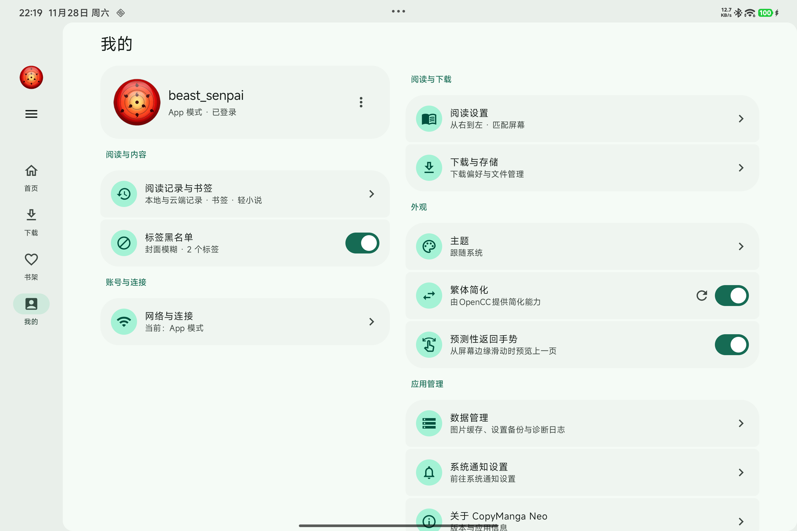</a></td></tr>
</table>

阅读设置与画质增强

<table>
<tr><th>阅读设置</th><th>显示设置</th></tr>
<tr><td><a href="screenshots/cmp/render-reader-settings.png">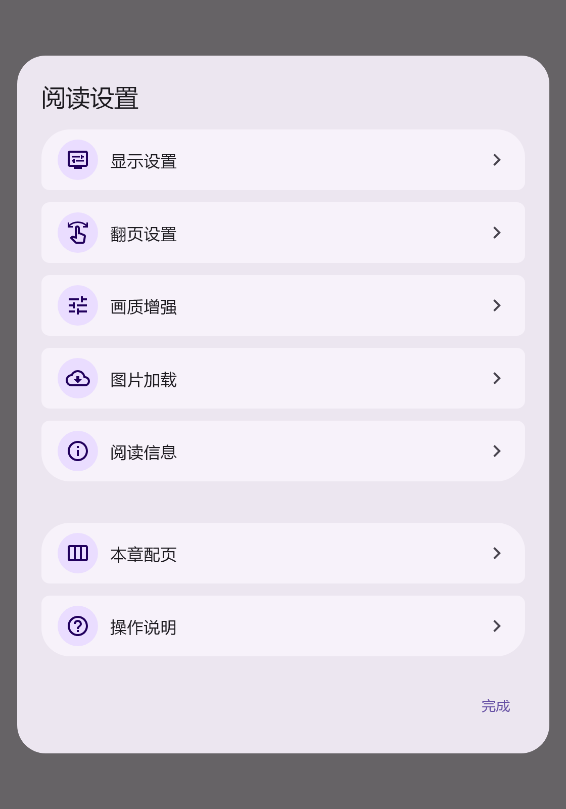</a></td><td><a href="screenshots/cmp/render-reader-display.png">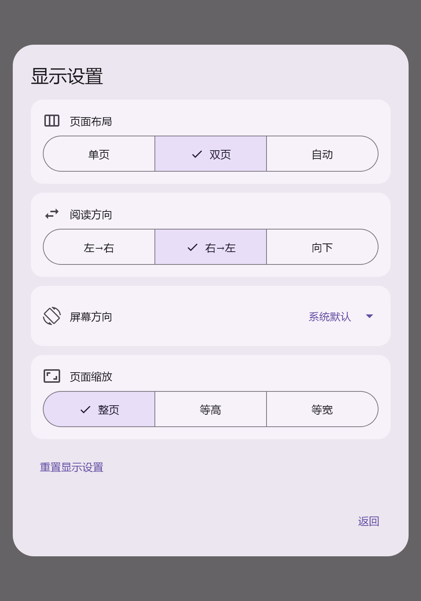</a></td></tr>
</table>

[查看画质增强面板](screenshots/cmp/render-reader-quality.png)

## 功能

- **探索与追更**　按作品、作者、汉化组或题材搜索，把漫画和轻小说加入书架，看更新、接着上次的位置读。
- **阅读漫画**　支持单页、双页和竖向连续阅读，可切换左右翻页方向，也能为某一章单独调整双页配对。部分设备支持锐化和实验性画质修复。
- **Android 鼠标与手写笔**　读漫画时可用鼠标滚轮翻页，右键打开阅读设置。用手写笔轻点页面两侧可翻页，轻点中央可呼出工具栏。
- **阅读轻小说**　可滚动或分页阅读，调整字体和单双栏排版，搜索正文、添加书签和标注。
- **离线阅读与导出**　无限制下载，可暂停和继续。漫画支持保存单张图片，也可将章节导出为 ZIP 或 CBZ。
- **个性化与备份**　可切换深浅主题、将繁体文字转为简体，以及备份和恢复设置与阅读数据。

## 反馈与开发

遇到问题时，请附上应用版本、设备型号、系统版本和复现步骤。如需附日志，可在「我的 → 设置 → 数据管理 → 诊断日志」导出，分享前请检查其中的内容。[提交问题](https://github.com/rchdliang/CopyManga_Neo/issues)

开发环境、各平台构建和打包步骤见[构建说明](docs/BUILDING.md)。另有[架构说明](docs/ARCHITECTURE.md)、[画质修复说明](docs/READER-RESTORATION.md)和[备份范围](PERSISTENCE.md)。

## 项目与许可

本项目为 AI 辅助开发的个人学习和测试项目，与[拷貝漫畫](https://copy4000.com/)官方无关，不接受赞助。漫画、轻小说和截图中的作品内容归原作者及相关权利方所有。

项目代码采用 [GPL-3.0](LICENSE)。感谢 [fumiama/copymanga](https://github.com/fumiama/copymanga)、[OpenCC](https://github.com/BYVoid/OpenCC)、[Anime4K](https://github.com/bloc97/Anime4K) 和 [Vulkan-Headers](https://github.com/KhronosGroup/Vulkan-Headers)。轻小说阅读器的部分代码改编自 [Kixyu Book](https://github.com/kkyu9527/kixyubook)。第三方组件、词典和模型保留各自的版权与许可声明。