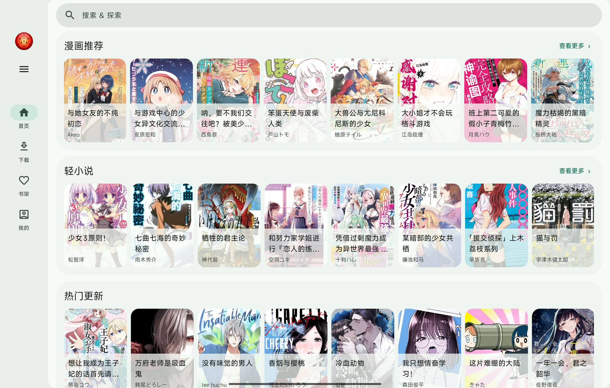
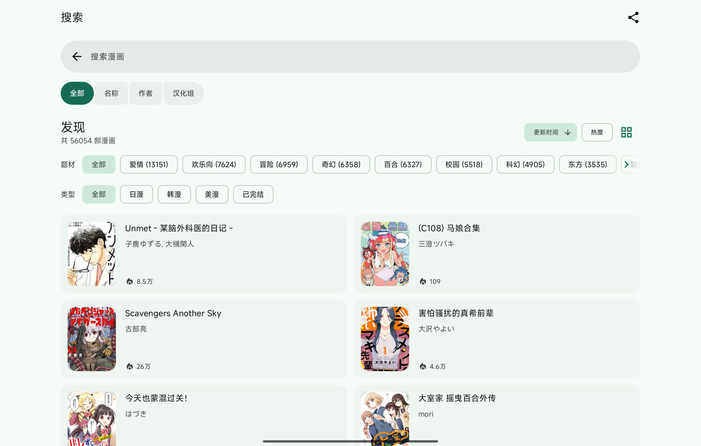
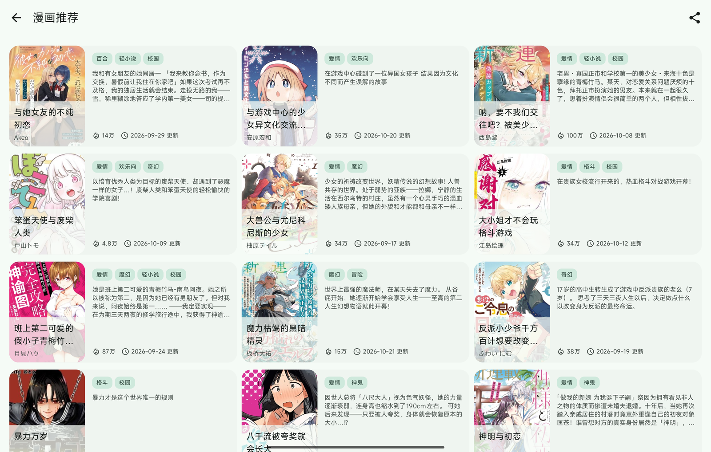
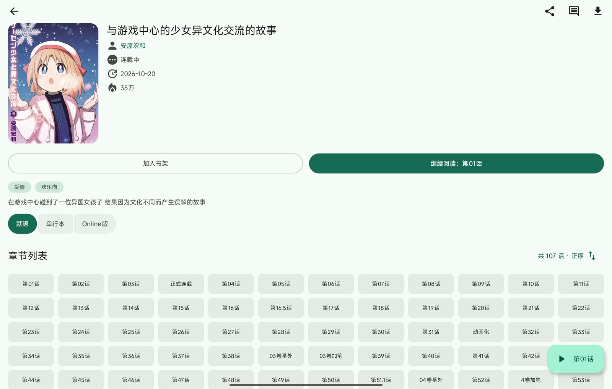
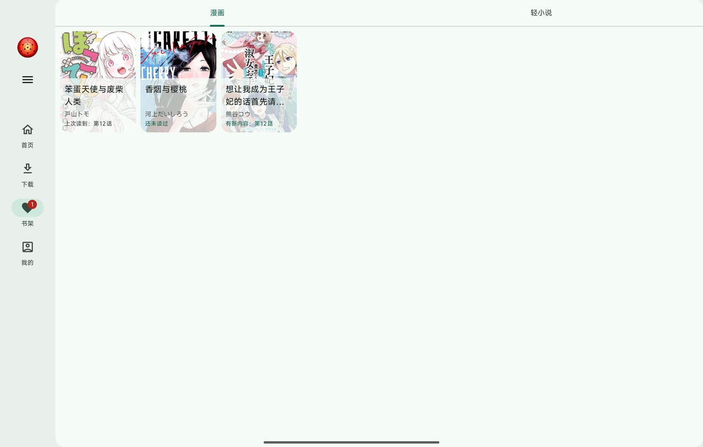
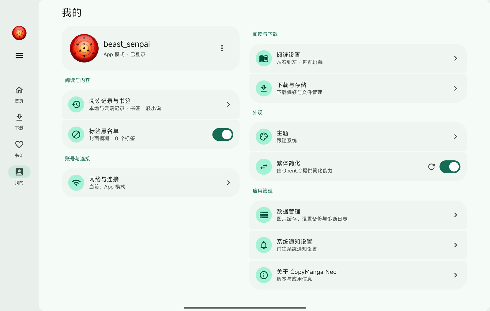
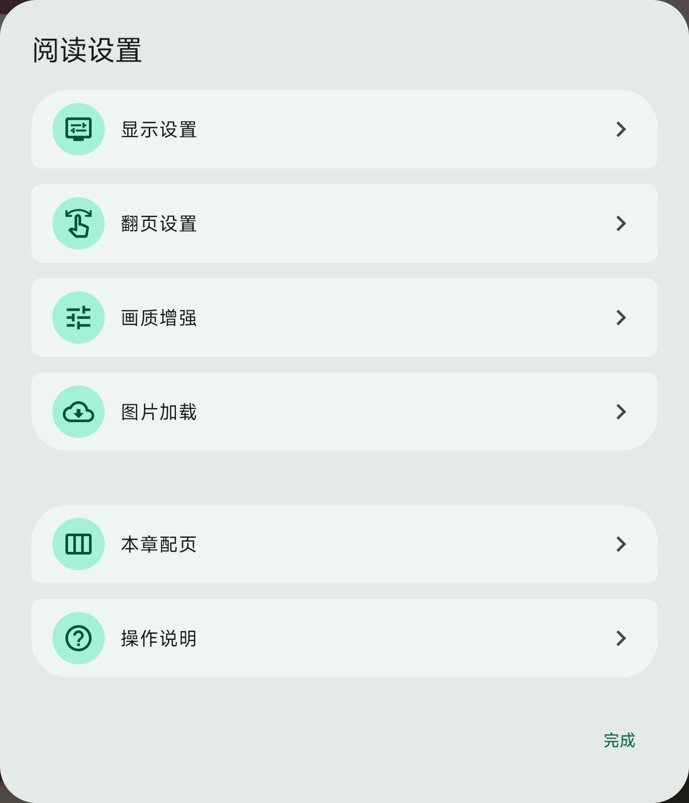
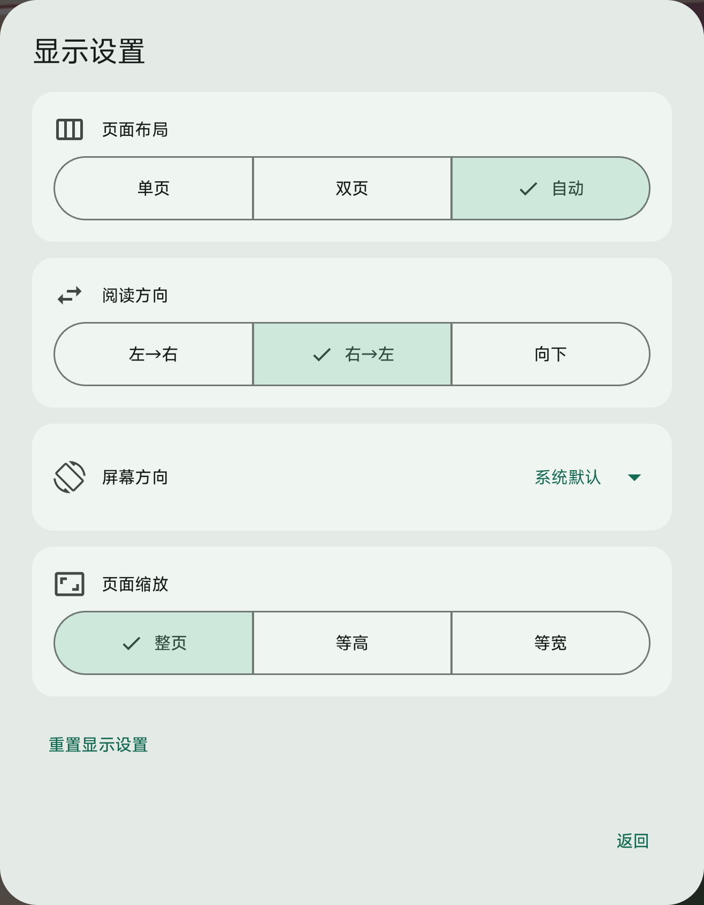
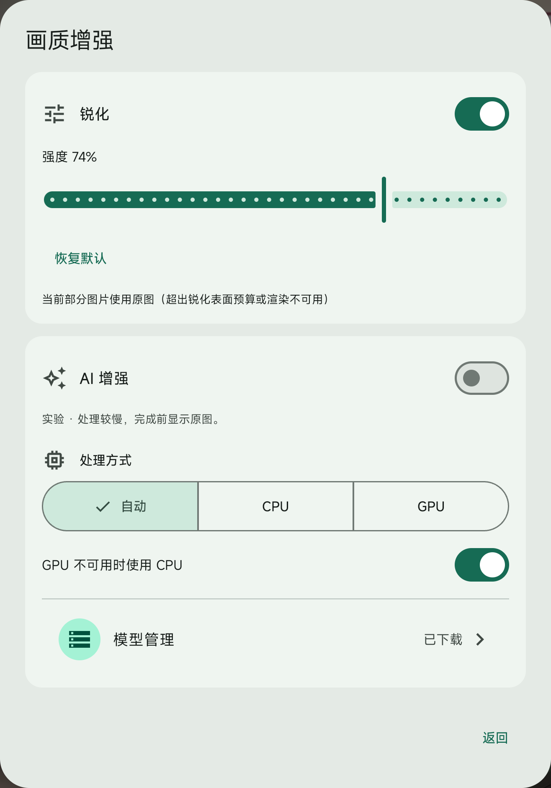

# CopyManga Neo

基于 Kotlin 与 Compose 的拷貝漫畫第三方客户端，提供漫画、轻小说阅读与离线下载。

[下载安装](https://github.com/rchdliang/CopyManga_Neo/releases) · [问题反馈](https://github.com/rchdliang/CopyManga_Neo/issues)

## 版本与平台

本文以 **CMP 分支**为主，独立 Android 分支的差异见下表。

原生 Android 版本计划近期停止维护，后续仅维护 CMP 版本。CMP 将作为项目的持续开发主线。

| 项目 | CMP 分支 | Android 分支 |
| --- | --- | --- |
| 平台 | Android、Windows、Linux；另有 iOS 与 Web/Wasm 构建目标 | Android |
| Android 系统要求 | Android 12 及以上 | Android 12 及以上 |
| 单页、双页、自动布局 | 支持，按漫画保存 | 支持，按漫画保存 |
| 锐化 | Android 13 及以上、桌面 | 暂无 |
| AI 增强（实验） | Android arm64、Windows x64 | 暂无 |

两个 Android 应用使用不同包名，可以并存；应用数据分别保存，备份格式不能直接互导。iOS、Web/Wasm 及桌面平台的构建条件和系统能力差异见 [构建说明](https://github.com/rchdliang/CopyManga_Neo/blob/CMP/docs/BUILDING.md)与[架构说明](https://github.com/rchdliang/CopyManga_Neo/blob/CMP/docs/ARCHITECTURE.md)。

### 各平台测试进度

| CMP 平台 | 当前测试情况与限制 |
| --- | --- |
| Android | 日常功能已进行较充分的实机测试，整体可用，仍可能存在缺陷。AI 增强耗时较长，保持实验性质，详见下方说明。 |
| Windows | 桌面验证主要在 Windows 进行，已检查启动、阅读器及部分原生增强功能；部分界面仍需优化，部分功能尚未充分测试。 |
| Linux | 尚未经过实机验证；编译或打包成功不代表实际功能已验证可用。 |
| iOS | 尚未经过 iPhone/iPad 实机验证；构建成功不代表安装、系统交互与日常功能已验证可用。工程最低部署目标为 iOS 16。 |
| Web/Wasm | 测试有限，尚未完成全面功能验证；受浏览器跨域、后台执行、文件与存储能力限制。 |

Web/Wasm 的具体边界：

- API 和图片加载受上游 CORS 策略约束；纯静态托管不能直接读取未开放跨域的漫画图片。部署方式与所需宿主能力见构建说明，不保证仅上传静态文件即可完整使用。
- 页面隐藏时暂停下载，不保证关闭页面后继续后台任务，也不支持严格的仅 Wi-Fi 网络绑定。
- 设置使用 local storage，二进制内容使用 IndexedDB，持久性与容量受浏览器策略影响；当前账号凭据仅保留在内存。
- 文件导出依赖浏览器的 File System Access 能力；分享、剪贴板、文件选择、通知和全屏等操作受浏览器支持情况与用户手势要求限制。
- 当前不提供锐化或 AI 增强。

## 功能

- **内容浏览**：漫画推荐、热门更新、最新上架、完结漫画与轻小说；支持作品、作者、汉化组和题材搜索，以及首页标签过滤。
- **书架与阅读记录**：收藏管理、更新提示、继续阅读、阅读历史和页面书签。
- **漫画阅读**：单页、双页与自动布局；从左到右、从右到左及竖向连续阅读；整页、等宽与等高显示；缩放、平移和键盘操作。
- **阅读设置**：按漫画保存布局、阅读方向、屏幕方向和缩放方式；按章节调整双页配对；支持翻页动画、音量键翻页、自动阅读与连续跨章。
- **离线下载**：章节选择、下载队列、暂停与恢复、失败重试、并发和速度限制；图片缓存与已下载内容分别管理。Android 支持下载通知与仅 Wi-Fi 下载。
- **图片与章节导出**：单张图片保存、分享，以及 ZIP/CBZ 章节导出。
- **轻小说阅读**：分卷目录、滚动与分页阅读、单栏与双栏排版；字体、间距与主题设置；书签、文本标注、正文搜索、插图浏览和离线缓存。
- **评论**：查看作品与章节评论。
- **外观与数据管理**：浅色、深色和跟随系统主题，Android 动态配色；设置与阅读数据备份、导入和恢复。

### 画质增强（CMP）

- **锐化**：可调强度，默认关闭；Android 需要 Android 13 及以上和硬件加速，桌面使用平台图像滤镜。
- **AI 增强（实验）**：自动、CPU 与 GPU 处理方式；模型约 2.65 MiB，首次使用确认后下载，校验完成后启用，可离线复用、删除和重新下载。
- **实际显示反馈**：区分等待、处理中、结果已应用和失败回退；增强完成前继续显示原图。双页同时显示两张图片时使用原图。

AI 增强默认关闭，处理耗时和画质收益取决于设备与图片。当前部分平板整页处理约需 50 秒，不适合逐页实时增强；输出分辨率增加不代表画质必然改善。iOS、Web/Wasm 和独立 Android 分支不提供此功能。

## 界面截图

以下为 CMP Android 平板实机界面，点击图片可查看大图。书架展示测试账号的空状态；截图仅裁切系统状态栏或设置弹窗区域并适度缩小，不改变页面内容。漫画封面及作品信息来自内容平台，版权归相关权利方所有。

<details open>
<summary>浏览与发现：首页、搜索、探索、专题、详情</summary>

<table>
  <tr><th>首页</th><th>搜索与筛选</th></tr>
  <tr>
    <td><a href="screenshots/cmp/android-tablet-home.png"></a></td>
    <td><a href="screenshots/cmp/android-tablet-search.png"></a></td>
  </tr>
  <tr><th>探索：漫画推荐</th><th>漫画专题</th></tr>
  <tr>
    <td><a href="screenshots/cmp/android-tablet-explore.png"></a></td>
    <td><a href="screenshots/cmp/android-tablet-topics.png"></a></td>
  </tr>
  <tr><th colspan="2">详情与章节</th></tr>
  <tr><td colspan="2"><a href="screenshots/cmp/android-tablet-detail.png"></a></td></tr>
</table>

</details>

<details>
<summary>书架与我的</summary>

<table>
  <tr><th>书架（测试账号空状态）</th><th>我的</th></tr>
  <tr>
    <td><a href="screenshots/cmp/android-tablet-bookshelf.png"></a></td>
    <td><a href="screenshots/cmp/android-tablet-profile.png"></a></td>
  </tr>
</table>

</details>

<details>
<summary>阅读设置与画质增强</summary>

<table>
  <tr><th>阅读设置</th><th>显示设置</th><th>画质增强</th></tr>
  <tr>
    <td><a href="screenshots/cmp/android-tablet-reader-settings.png"></a></td>
    <td><a href="screenshots/cmp/android-tablet-reader-display.png"></a></td>
    <td><a href="screenshots/cmp/android-tablet-reader-quality.png"></a></td>
  </tr>
</table>

</details>

## 安装

从 [Releases](https://github.com/rchdliang/CopyManga_Neo/releases) 选择对应分支、平台和架构的安装包。Android 使用 APK；Windows 安装包及其他平台产物以对应版本实际提供的文件为准。

目前已发布的 `v0.10.20` 为独立 Android 版本；本文包含 CMP 当前源码中的新增功能，不代表该旧版安装包已具备这些功能。开发构建与正式发布请以分支、提交号和发布说明区分。

Android 覆盖更新需要包名与签名一致。CMP 与独立 Android 不能相互覆盖更新；更新前可在应用内备份数据。

## 构建

使用完整 JDK 21 和仓库自带的 Gradle Wrapper。Android 构建需要项目指定版本的 Android SDK；iOS 构建需要 macOS 与 Xcode。

### CMP 分支

```powershell
# CMP Android Debug
.\gradlew.bat :app:assembleDebug

# CMP 桌面运行
.\gradlew.bat :desktopApp:run -PenableAndroid=false
```

macOS/Linux 使用 `./gradlew`。CMP Android arm64 与 Windows x64 的普通构建会校验并打包 AI 运行时，模型不随包分发；全新环境需要准备原生构建工具链，或使用经校验的运行库缓存。

平台打包、签名、版本配置与网络配置见 [构建说明](https://github.com/rchdliang/CopyManga_Neo/blob/CMP/docs/BUILDING.md)，AI 运行库与模型来源见 [增强构建说明](https://github.com/rchdliang/CopyManga_Neo/blob/CMP/docs/SR-BUILDING.md)。请勿提交本地签名材料、账号凭据或私有配置。

### 原生 Android 分支

原生 Android 分支为独立的 `:app` 工程，不包含 CMP 桌面模块或 AI 原生运行库构建任务。

```powershell
.\gradlew.bat :app:assembleDebug
.\gradlew.bat :app:assembleRelease
```

Release 构建需要本地 `keystore.properties` 和对应签名密钥库。SDK 与依赖版本以该分支的 `app/build.gradle.kts`、`gradle/libs.versions.toml` 为准。

## 已知限制与反馈

- 在线内容和账号功能依赖上游服务；遇到请求限流时应停止重试并稍后再试。
- Android 支持后台下载；桌面需要应用进程保持运行，iOS 下载要求保持前台，Web 受浏览器后台执行、存储与跨域策略限制。
- 系统手势导航提示可能由系统临时显示；沉浸阅读不禁用系统返回手势。
- 提交 [Issue](https://github.com/rchdliang/CopyManga_Neo/issues) 时，请注明分支、应用版本、系统版本、设备型号与复现步骤；必要时附上截图和应用导出的日志。

## 项目与许可

本项目为 AI 辅助开发的个人学习和测试项目，与拷貝漫畫官方无关，不接受赞助。漫画及轻小说内容来自拷貝漫畫，版权归原作者及相关权利方所有。

项目代码采用 [GNU General Public License v3.0](LICENSE)。第三方库、原生运行时和模型保留各自许可证。致谢 [fumiama/copymanga](https://github.com/fumiama/copymanga) 及项目使用的开源组件。
